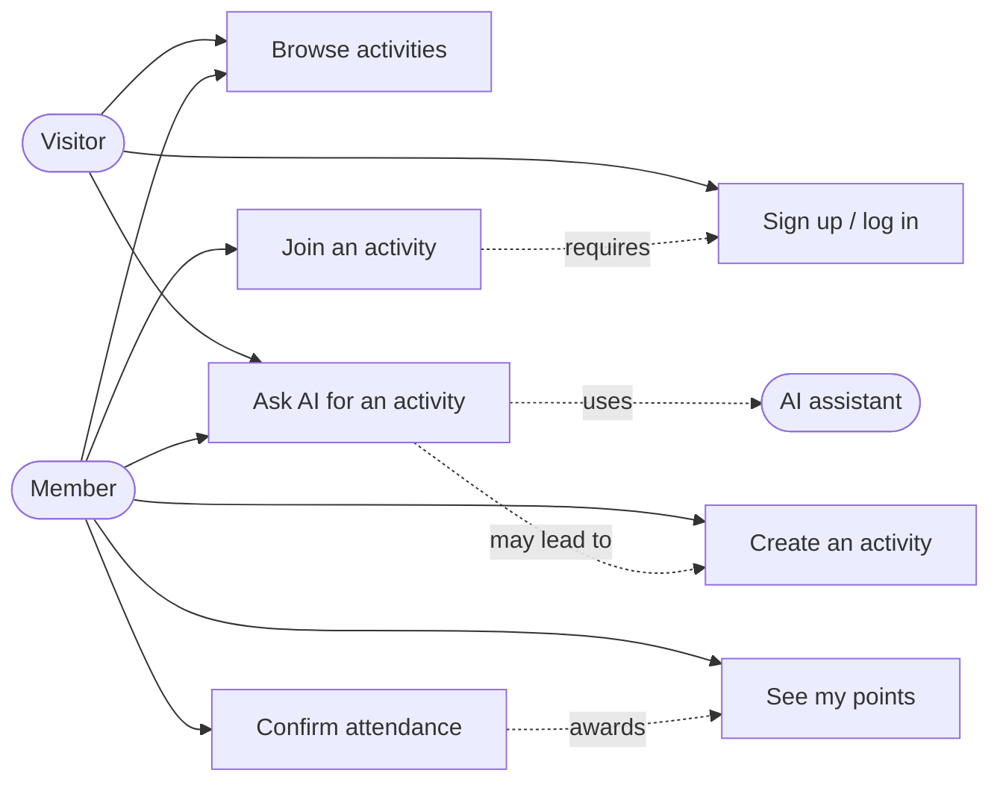
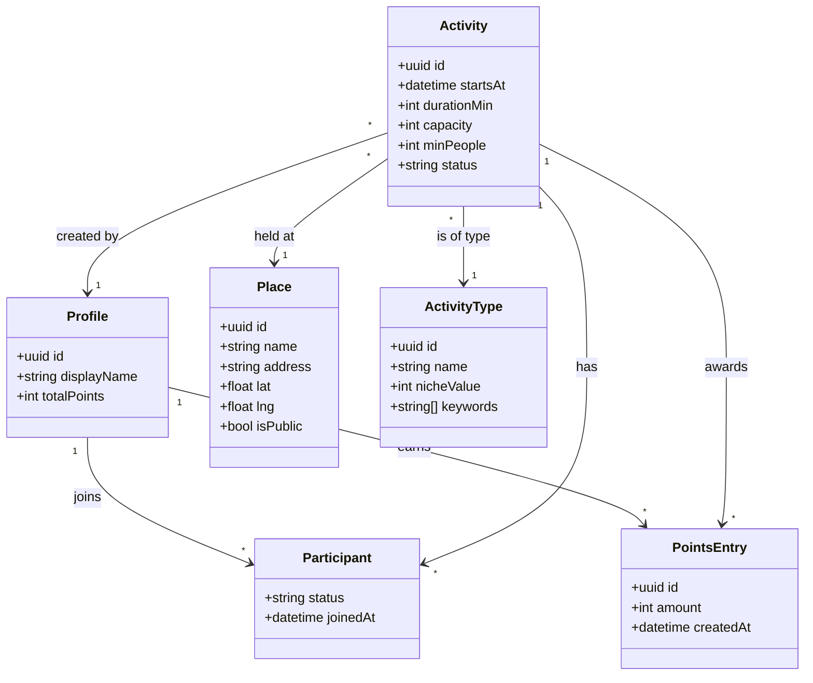
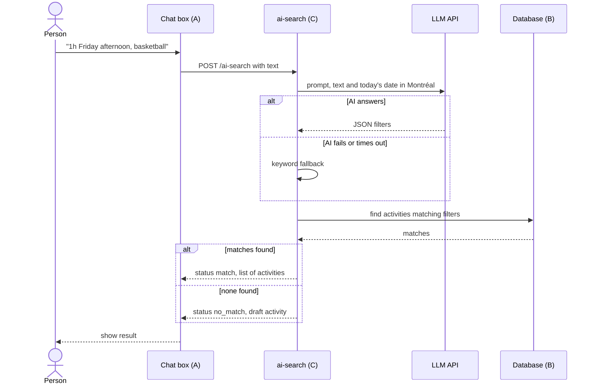
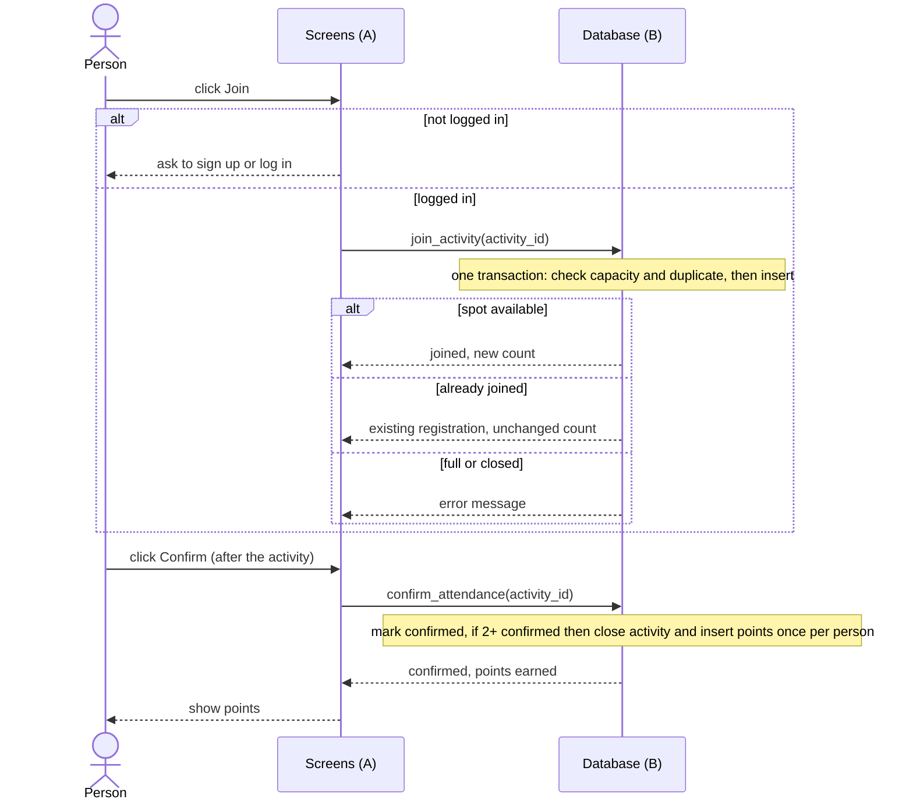
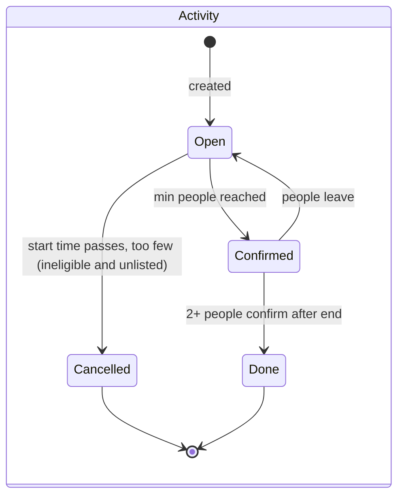
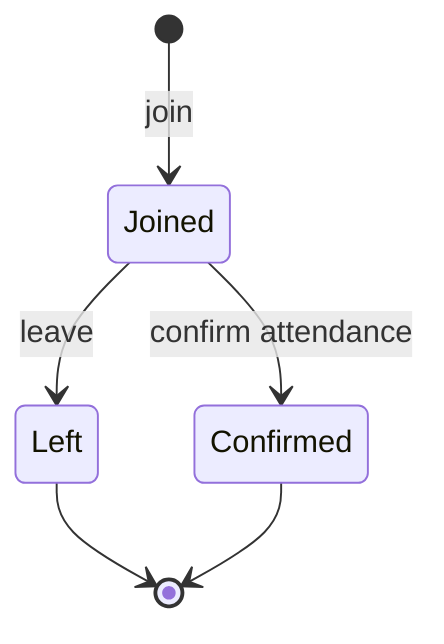
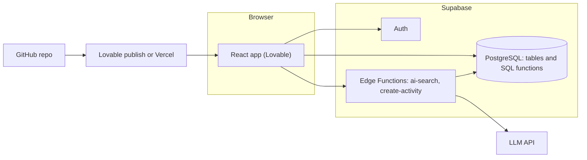

# Outside Together: 24-hour plan

Web app for finding people near you for a spontaneous 1-hour activity. Montréal first. Browsing is public, joining needs an account, points depend on how niche the activity is.

Diagrams below are Mermaid: they render on GitHub, and in VS Code with a Mermaid preview extension.

---

## 1. Scope

**Must have (demo path)**
1. Public board of activities
2. Sign-up / login
3. Chat box: sentence in, matches out (AI translates, database decides)
4. Join an activity (capacity respected, live count on refresh)
5. No match: a draft activity can be created
6. Confirm attendance, points weighted by niche value

**Cut first if late** (in this order): create-activity flow, points, AI chat (fall back to a filter form).
Browsing and joining must survive no matter what.

**Not now:** other cities, French/English switch, maps, real-time push, recaps/badges, safety extras beyond "public places only".

---

## 2. Roles

| | Owns | Tools |
|---|---|---|
| **A** | Screens and user flow | Lovable, GitHub |
| **B** | Tables, login, join and points rules | Supabase (Postgres, Auth, SQL functions) |
| **C** | AI request handling, seed data, pitch | Supabase Edge Functions, LLM API |

Rules: one person (A) prompts Lovable. One change per prompt. Keep about 30 of the 100 credits in reserve for the last hours.

---

## 3. Contracts (agree on these in hours 0-2)

### 3.1 Tables (B creates, C seeds, A reads)

| Table | Columns |
|---|---|
| `profiles` | `id` (= auth user id), `display_name`, `total_points` |
| `places` | `id`, `name`, `address`, `lat`, `lng`, `is_public` |
| `activity_types` | `id`, `name`, `niche_value` (1-5), `keywords` (text[]) |
| `activities` | `id`, `type_id`, `place_id`, `starts_at`, `duration_min`, `capacity`, `min_people`, `status`, `created_by` |
| `participants` | `activity_id`, `user_id`, `status` (`joined` / `confirmed` / `left`), `joined_at` |
| `points` | `id`, `user_id`, `activity_id`, `amount`, `created_at`; unique (`user_id`, `activity_id`) |

### 3.2 AI contract (C implements, A consumes)

The AI only translates. The function passes today's date so "Friday" becomes a real date.

AI output (JSON only):

```json
{ "activity": "basketball", "date": "2026-11-27", "time_from": "15:00", "time_to": "18:00", "vibe": null }
```

Unknown fields are `null`. The function never trusts the AI for facts, only for filters.

Response of `POST /ai-search` to the chat box:

```json
{ "status": "match", "matches": [ { "...activity..." } ], "message": "Found one at 5:30 pm, 3 people are in." }
{ "status": "no_match", "draft": { "type_id": "...", "place_id": "...", "starts_at": "...", "capacity": 6 }, "message": "Nothing yet. Create it?" }
{ "status": "fallback", "matches": [ ... ] }
```

### 3.3 Server functions

| Name | Who calls it | What it does |
|---|---|---|
| `ai-search` (Edge Function) | Chat box | Sentence to filters to matches or draft |
| `create-activity` (Edge Function) | Chat box / form | Validates a draft, inserts it, adds the creator as first participant |
| `join_activity()` (SQL function) | Join button | Checks capacity and duplicates, inserts participant, all in one transaction |
| `confirm_attendance()` (SQL function) | Confirm button | Marks the caller `confirmed`, and when 2+ are confirmed, closes the activity and awards points once per person |

### 3.4 Points rule (proposal, change it if you prefer)

`points = 10 + 5 × niche_value`, once per user per activity, only after 2+ participants have confirmed. `niche_value` is a fixed number per activity type (set by C in seed data), never typed by users. Examples (placeholders): walk 1, basketball 1, study outside 2, chess 3, photo walk 4, urban sketching 5.

---

## 4. Timeline (24 hours)

| Hours | A: screens | B: data and rules | C: AI and content | Checkpoint |
|---|---|---|---|---|
| **0-2** | Together: freeze section 3, create Supabase project, connect Lovable, set up GitHub branches | | | Contracts written down |
| **2-10** | First Lovable prompt, pages with fake data: board, activity page, login, profile, chat box | Tables, Auth, row-level security, `join_activity()` | Seed data (8-10 activities), AI prompt tested on 20 sentences, `ai-search` v1 | Join works with 2 accounts on real DB |
| **10-15** | Replace fake data with real calls | Help connect, fix permissions | Connect `ai-search` to DB, add keyword fallback | Chat box returns real matches |
| **15-19** | Create-activity screen, confirm button, points display | `confirm_attendance()`, points table | `create-activity`, no-match draft, message wording | Full path works once end to end |
| **19-22** | Fix bugs only, polish the demo path, test on a phone | Test with 3 accounts, edge cases (full, double join) | Re-test 20 sentences, API-failure test | Demo path passes 3 times in a row |
| **22-24** | Pitch slides/screens | Freeze, last deploy | Demo script, backup screen recording | Pitch rehearsed |

No new features after hour 19.

---

## 5. UML diagrams

### 5.1 Use cases



### 5.2 Classes (data model)



### 5.3 Sequence: ask the AI



### 5.4 Sequence: join, confirm, points



### 5.5 States: activity and participant





### 5.6 Deployment



---

## 6. Git workflow

- One branch per person (`frontend-...`, `backend-...`, `ai-...`). Merge into `main` at every checkpoint, not at the end.
- Always `git pull --no-rebase` before `git push`.
- Never `git push --force`.
- Secrets (`LLM_API_KEY`) live in Supabase secrets, never in the repo.

---

## 7. Demo script (about 3 minutes)

1. Open the board as a visitor: activities are visible, Join asks for an account.
2. Type: "I have 1 hour Friday afternoon, I want to play basketball."
3. The assistant shows a matching activity. Sign up, choose Join, and refresh to see the count go up.
4. Second account (other browser): ask for something with no match, review the draft, then choose Publish.
5. After the activity: two accounts confirm, points appear, a niche activity earns more than a common one.
6. One sentence on what is next: more cities, safety features, French/English.

Backup: a screen recording of steps 2-5, in case the network fails.

---

## 8. Risks and answers

| Risk | Answer |
|---|---|
| Empty board | Seed 8-10 real activities |
| AI invents places | AI only produces filters, the database decides |
| AI/API down | Keyword fallback, then plain filter form |
| Two people take the last spot | Capacity check and insert in one transaction |
| Points farming | Fixed niche values, once per person per activity, 2+ confirmations |
| Lovable credits run out | One change per prompt, 30 credits reserved |
| Git conflicts | Small frequent merges, pull before push |
